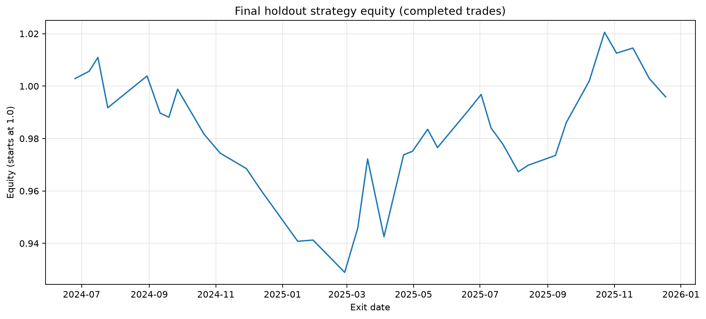
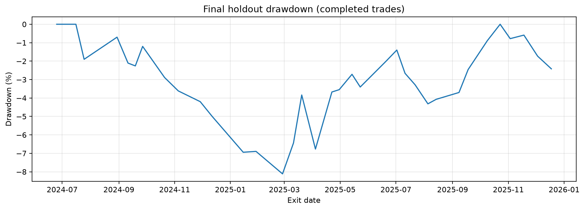
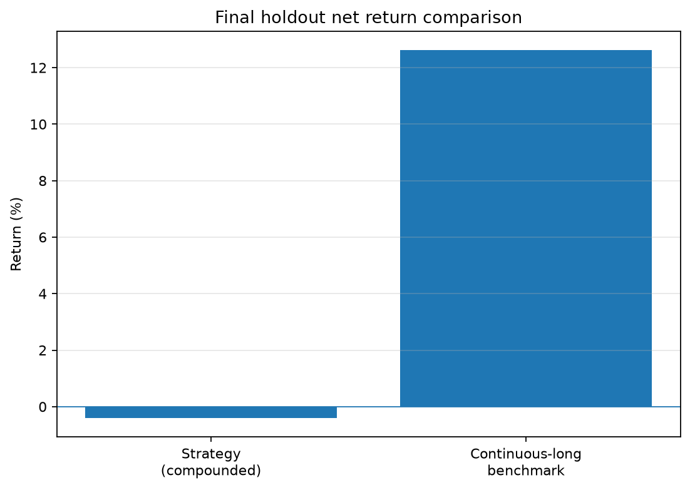

# Candlestick AI — Final Holdout Diagnostic Report

- **Holdout:** 2024-06-04 to 2025-12-31
- **Holdout rows:** 393
- **Eligible signal rows:** 388
- **Trades:** 36

## Classification

- Accuracy: **63.92%**
- Balanced accuracy: **88.91%**
- Macro F1: **0.5170**
- See `classification_report.csv`, `confusion_matrix.csv`, and `confusion_matrix.png` for per-class diagnostics.

## Trading performance

- Strategy: **bullish_only**
- Confidence threshold: **0.7**
- Holding horizon: **5 sessions**
- Assumed round-trip cost: **10 bps**
- Compounded net return (summary): **-0.413%**
- Win rate: **52.778%**
- Profit factor recomputed from trades: **0.996**
- Maximum drawdown based on completed trades: **-8.114%**

### By predicted pattern

| Pattern | Trades | Win rate | Mean net | Median net | Compounded net | Profit factor |
|---|---:|---:|---:|---:|---:|---:|
| bullish_engulfing | 26 | 50.000% | 0.002% | 0.049% | -0.211% | 1.003 |
| hammer | 10 | 60.000% | -0.012% | 0.091% | -0.202% | 0.975 |

### By confidence band (descriptive only)

| Confidence | Trades | Win rate | Mean net | Median net | Compounded net | Profit factor |
|---|---:|---:|---:|---:|---:|---:|
| 0.70–<0.80 | 8 | 50.000% | -0.153% | -0.210% | -1.333% | 0.790 |
| 0.80–<0.90 | 13 | 61.538% | 0.682% | 0.864% | 9.141% | 3.973 |
| 0.90–1.00 | 15 | 46.667% | -0.514% | -0.709% | -7.521% | 0.316 |

## Benchmark comparison

- Strategy compounded net return: **-0.413%**
- Continuous-long benchmark net return: **12.627%**
- Excess return versus benchmark: **-13.040 percentage points**
- Benchmark: Continuous long from first holdout Open to final Close; one illustrative round-trip cost; excludes dividends and financing costs.

## Assumptions and limitations

- The strategy was frozen before the final holdout; do not tune against this period and continue to call it an untouched test.
- Confidence bands are descriptive only and must not be used to choose a new threshold on this same holdout.
- Pattern-class confidence is not the probability of a profitable trade.
- The sample contains relatively few trades, so performance estimates are uncertain.
- Equity and drawdown are calculated at completed-trade exits, not daily mark-to-market portfolio values.
- The continuous-long benchmark excludes dividends and financing costs and uses one illustrative round-trip cost.
- Results depend on the dataset, labels, execution assumptions, and modeled costs; this is not evidence of a live-trading edge.

## Generated files

- `classification_report.csv`, `confusion_matrix.csv`, `confusion_matrix.png`
- `trades_by_pattern.csv`, `trades_by_confidence.csv`
- `trades_with_equity_and_drawdown.csv`
- `equity_curve.png`, `drawdown.png`, `benchmark_comparison.png`
